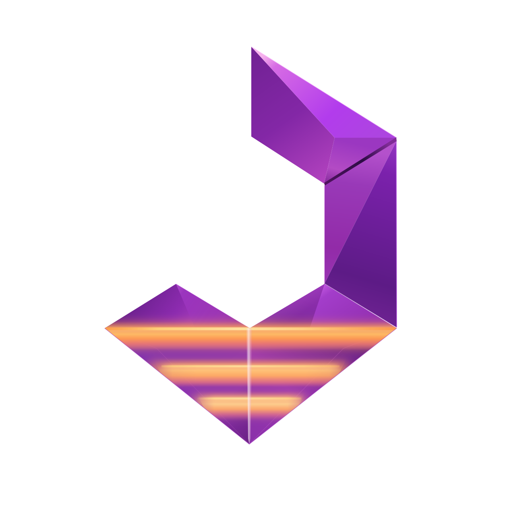

  
  <h1>Noctemblith · 녹템블리스 (그믐석)</h1>
  
Misskey를 기반으로 독자적인 정체성을 갖춘 연합형 소셜 플랫폼입니다.

  
<a href="https://noctemblith.manafield.studio/">Noctemblith</a> · <a href="https://github.com/eventide-manafield/noctemblith">소스 코드</a> · <a href="./docs/README.md">문서</a> · <a href="./docs/branding.md">브랜드 자산과 :noctemblith: 이모지</a>

> **Noctemblith는 [Misskey](https://github.com/misskey-dev/misskey)의 포크입니다.** [AGPL-3.0 라이선스](./LICENSE)를 따르며, 원본 프로젝트와 기여자에게 감사드립니다.

  

